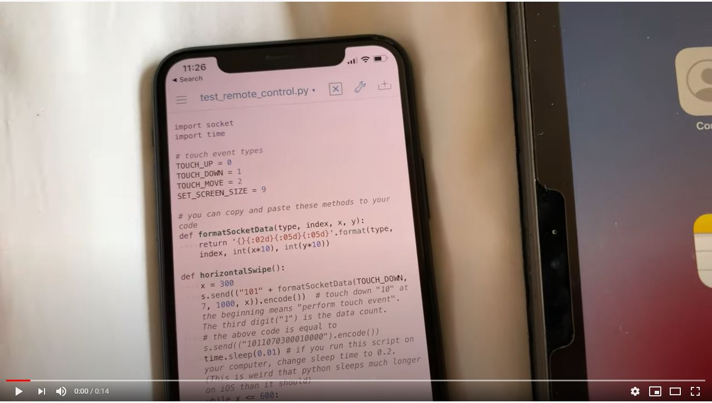
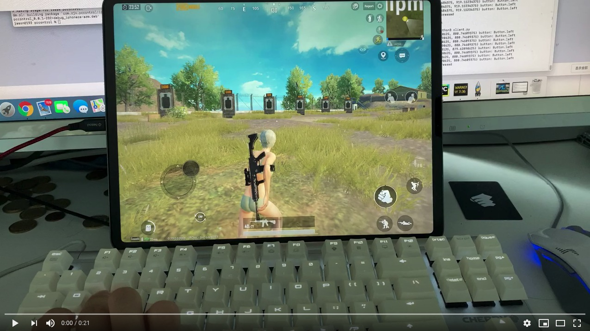
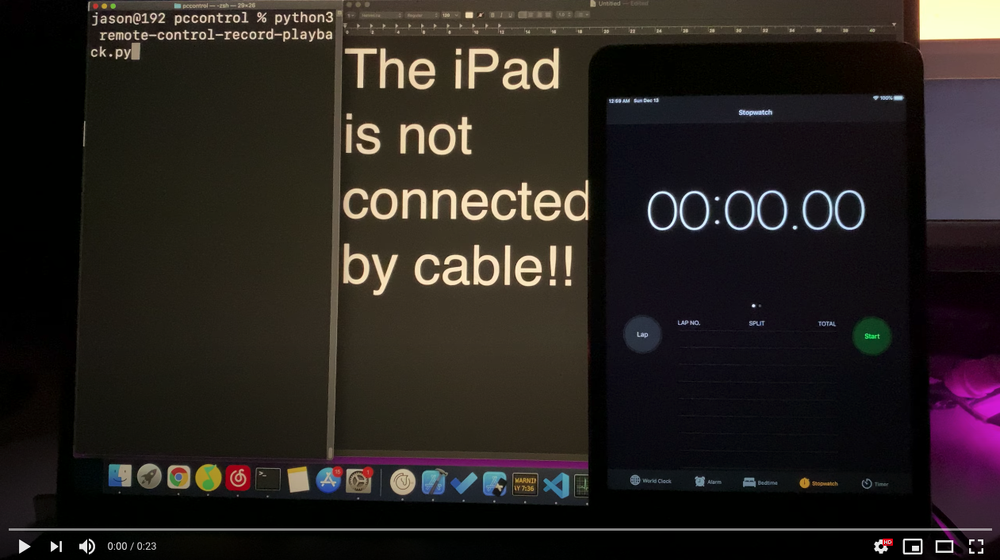

# IOS-SFP

本项目是独立维护的 ZXTouch rootless/roothide 中文版本（项目名 IOS-SFP；Python 模块仍为 `zxtouch`），增加 AX 节点查询、简体中文远程控制台和 socket 断连处理。安装包在本项目 GitHub Actions 的 `IOS-SFP-rootless-deb` / `IOS-SFP-roothide-deb` 产物中。

## 来源与许可

- 原始 ZXTouch：[xuan32546/IOS13-SimulateTouch](https://github.com/xuan32546/IOS13-SimulateTouch)。
- iOS 15–18 rootless/roothide 移植：[Epic0001/zxtouchrootless](https://github.com/Epic0001/zxtouchrootless)。保留原有 Git 历史和 [LICENSE](LICENSE)。
- 可选的扁平 AX 元素接口（任务 31）参考并调用独立项目 [witchan/ios-mcp](https://github.com/witchan/ios-mcp) 的本机服务；ios-mcp 不随本安装包分发。任务 32 是本项目基于应用、窗口和数字 AX 属性候选的原生元素树，不依赖 ios-mcp；同一 AX 句柄跨来源只返回一次，不按文字或位置合并不同控件。

## iOS 15.8.8 实测

`axcn3` 真机状态接口返回 `serviceOnline=true`，6000/8080 可用。网页控制服务离线的根因是 Socket 命令缺少 `\r\n`，现已修复。任务 32 原始 SpringBoard 崩溃报告显示 socket 队列调用 `AXFrontBoardFocusedAppPID` 触发主队列 SIGTRAP；`axcn4` 把该查询移至主队列后不再导致崩溃。`axcn6` 真机报告前台 PID 为 `904948036`，六种 AX 子节点属性均返回 `-25215`，创建的是无效应用代理。`axcn7` 真机已将前台 PID 修正为实际进程 `6235`，六项 AX 属性均返回 `-25212`（无值），查询后 6000/8080 保持在线。`sfp2` 真机前台 PID 为 `8211`，六项字符串 AX 属性仍全部返回 `-25212`；查询后 SpringBoard 及 6000/8080 仍在线。`sfp3` 真机读数：前台 PID `9741`，`3015=0/9`、`3022=0/9`、`3029=0/2`、`3031=0/2`、`5001=0/1`，字符串 `AXChildren` 等六项全部 `-25212/0`；SpringBoard 和 6000/8080 保持在线。`sfp5` 真机 0.49 秒返回 7 个节点、3 个根子节点，包含中文标签、类型和 frame；普通元素的 `5001` 再次返回它自己，造成看似父子重复。`sfp6` 改用 ios-mcp 的应用级与窗口级六组候选，只有应用的 `5001` 用来建立窗口层；`CFEqual` 判断同一 AX 元素跨组重复，标签/坐标相同但 AX 元素不同的控件仍分别保留。抓取全部放到主线程，重试等待留在工作线程，单项消息超时 0.5 秒、总节点上限 50。`sfp6` 真机实测 0.27 秒返回应用 → 1 个真实窗口 → 48 个候选元素，共 50 节点；无父子自重复、无相同字段组，查询后 6000/8080 均在线。`sfp7` 将原生数字候选树总节点上限提高到 2000，CFHash 分桶后用 CFEqual 比较 AX 身份，支持应用级和窗口级候选集的完整合并；响应带 `limitReached` 标记，用于识别是否触顶。`sfp7` 真机 0.44 秒返回 61 个节点：1 个应用、1 个窗口、59 个候选元素，`limitReached=false`，查询后 6000/8080 在线。`sfp8` 将 2000 上限精确计为候选元素数量，应用与窗口结构节点不占配额；响应同时包含 `candidateCount`、总 `count` 和 `limitReached`。iOS 15.8.8 设置页真机实测 0.27 秒返回 `candidateCount=22`、`count=24`（应用 1 + 窗口 1 + 元素 22），`limitReached=false`，遍历数与总数相同，6000/8080 查询后仍在线。刚 Respring 且前台应用尚未建立时任务 32 返回 `ZXTouchAX: 1: AX runtime or foreground PID unavailable`；解锁并打开设置页后立即成功。

`sfp9` 添加桌面 SpringBoard PID 回退、AX 窗口上下文字段及中文控制台的脚本编辑、图色、元素工具。iOS 15.8.8 真机桌面确认前台为 SpringBoard，任务 32 于 0.28 秒返回 PID `24601`、9 个真实窗口、32 个候选元素、总 42 节点，遍历数一致且 `limitReached=false`；两组字段相同的不同节点仍分别保留，抓取后 6000/8080 在线。桌面 AX 唯一“设置”候选经屏幕 scale=2 换算到物理像素后触摸，前台实际切换到 `com.apple.Preferences`。新版扩展任务 33 为手机端 PNG 模板匹配：支持模板数组、ROI、多尺度、多结果和可选 mask PNG，标准 alpha 语义为 A=255 参与、A=0 跳过；任务 34 直接按屏幕逻辑点执行 AX 命中测试，不必先枚举整棵树。任务 30 现在返回 `image/png` 无损截图。已有 Vision OCR task 27 接入控制台 `/api/ocr`，并修复默认最小文字高度和空截图路径。元素工具抓取树时同步抓 PNG，在图上画出所有 AX frame，点击框可选中节点、导出 Python 定位代码和标注 PNG；图色工具支持拖选、裁剪 PNG、独立 PNG 模板/掩模上传即测，以及脚本包模板入口。ios-mcp 的 PaddleOCR/OpenCV 静态 worker 需要额外模型与 arm64 构件，本版本先复用已有手机端 Vision OCR，不把 Paddle 依赖误写进 tweak。无令牌请求继续返回 403，改版控制台工具仍需通过新包完成真机验收。

---

A system-wide touch simulation library for iOS. It simulates touches, plays back recordings, and runs automation scripts without injecting into any app process.

---

## Compatibility

| Jailbreak | iOS | Status |
|-----------|-----|--------|
| Roothide / Serotonin | 15.8, 16.6.1 | Working |
| Dopamine (rootless) | 16.4.1, 16.6.1 | Working |
| NathanLR (rootless, semi-untethered) | 16.5.1 to 16.6.1 | Working, install `_rootless.deb` |
| Dopamine 3 (rootless) | 17.0 to 17.7 | Working, tested on 17.6 |
| Dopamine 3 (rootless) | 18.x | Working, tested on 18.5 |

iOS 17 is tested on an iPad 7th generation running 17.6 with Dopamine 3 and ElleKit.

iOS 18 is tested on 18.5 with Dopamine 3. iOS 18 does not let SpringBoard start processes, so on 18 scripts are run by zxtouch-runner, a small background daemon the package installs. It runs as `mobile`, so scripts have the same permissions they have on earlier versions.

---

## What this fork changes

Compared to the original ZXTouch:

- Runs on iOS 15 to 18 under rootless (Dopamine, Dopamine 3, NathanLR) and roothide (Serotonin)
- `image_match` rebuilt on `Accelerate.framework`, so OpenCV is gone and the package stays small
- Color picker, color searcher, OCR, and volume-down stop all work again
- Python scripts auto-detect Procursus Python 3.8 to 3.12, prefer versioned interpreters over the `python3` symlink, and report real tracebacks
- Adds a rebuilt panel and script browser, dark mode, a recording editor, a remote dashboard, iOS Shortcuts actions, and button-pattern automation triggers
- The "Script Finished" popup can be turned off in Settings, then Script

---

## Requirements

Python 3 from Procursus is required for `.py` scripts on every jailbreak. Install it from Sileo by searching for `python3`. ZXTouch no longer ships its own runtime: the bundled `python3.7` aborted at dyld load on rootless because its libpython dylib pointed at a `/usr/lib` path that does not exist there.

Dopamine and Dopamine 3 (rootless):

- iOS 15.0 to 18
- [Dopamine](https://ellekit.space/dopamine/), with Dopamine 3 for iOS 17 and 18

NathanLR (rootless, iOS 16.5.1 to 16.6.1):

- Semi-untethered, so reopen the [NathanLR](https://www.nathanlr.com/) app after each reboot to reactivate tweaks
- Install the `_rootless.deb`, because NathanLR uses the rootless bootstrap under `/var/jb` rather than roothide

Roothide and Serotonin:

- iOS 15.0 to 16.6.1
- [Serotonin](https://github.com/roothide/Serotonin) or another roothide-compatible jailbreak

---

## Installation

下载本项目构建包：

1. 打开 [IOS-SFP Actions](https://github.com/softwarpp/IOS-SFP/actions)。
2. 选择最新的成功构建，下载 `IOS-SFP-rootless-deb`（Dopamine / NathanLR）或 `IOS-SFP-roothide-deb`（Roothide / Serotonin）。
3. 安装解压得到的 `.deb`，安装完成后 Respring，让 SpringBoard 加载插件。

---

## Demo videos (original)

Remote controlling:
[](https://youtu.be/gdSGO6rJIL4)

Instant controlling (PUBG Mobile):
[](https://youtu.be/XvvWHL6B3Tk)

Recording and playback:
[](https://youtu.be/WeYMx4z8N2M)

Demo #4: [OCR](https://youtu.be/xt4BvgsSGkc)

Demo #5: [Touch Indicator](https://youtu.be/AU7zG_-W2tM)

Demo #6: [Color Picker](https://youtu.be/tserB05_B9E)

---

## Usage

After installation the tweak listens on port 6000. Send commands in the defined format from any language. A Python client is included for convenience.

### Panel (volume button)

Double-click volume down to open or close the panel.

- Tap a script to run it immediately
- Open the settings popup first to set repeat count, speed, and interval before running
- REC starts a touch recording
- STOP ends whichever is running, a recording or a script
- Settings, then Dark Mode, toggles the dark theme for both the app and the panel

### Scripts and examples

Example scripts install with the `.deb` under `/var/mobile/Library/ZXTouch/scripts/examples/`.

The app keeps a script registry at `/var/mobile/Library/ZXTouch/config/tweak/script_registry.plist`, which it uses for script metadata, icons, README previews, and trigger script selection.

### Recording editor

Tap a `.bdl` bundle whose entry file is a raw recording to open its timeline editor. From there you can:

- Tap a step to edit its coordinates, delay, toast text, app identifier, or raw command
- Reorder steps in edit mode
- Swipe a step to duplicate it, or delete unwanted steps
- Insert a tap, swipe, wait, toast, or app launch
- Save the recording and play the edited result immediately

### Remote dashboard

Enable Settings, then Web Server, and tap the dashboard URL row to copy the private address. Open that address from a phone, tablet, or computer on the same Wi-Fi network.

Scripts searches and filters the library, runs or stops scripts, downloads entries, and controls recording. Assets uploads files such as image-matching templates into a selected script bundle. Logs follows, filters, copies, exports, or clears runtime output. Device shows live service state, display size, orientation, battery, foreground app, and server diagnostics.

The URL contains a private access token. Do not share it outside your local network. Dashboard hosting runs inside SpringBoard, so it remains available when the ZXTouch app is closed.

### Automation triggers

Open Settings, then Automation, in the app to assign actions to button click patterns. Volume Up, Volume Down, and the Home Button can each be set to 1-5 clicks and run Smart Toggle, Toggle Panel, Stop Script, Toggle Recording, or a selected `.bdl` script.

---

## Documentation (Python)

### Installation

On an iOS device, the ZXTouch Python module installs with the `.deb`.

On a computer, for remote control, copy the `zxtouch` folder from [`layout/usr/lib/python3.7/site-packages`](https://github.com/xuan32546/IOS13-SimulateTouch/tree/0.0.6/layout/usr/lib/python3.7/site-packages) to your Python `site-packages` directory.

### Create a ZXTouch instance

```python
from zxtouch.client import zxtouch
device = zxtouch("127.0.0.1")  # use device IP for remote control
```

---

## Instance methods

### API status

| Method | Status |
|--------|--------|
| `touch` / `touch_with_list` | Working |
| `switch_to_app` | Working |
| `show_alert_box` | Working |
| `prompt_input` | Working |
| `run_shell_command` | Working |
| `show_toast` | Working |
| `pick_color` | Working |
| `search_color` | Working |
| `accurate_usleep` | Working |
| `play_script` / `force_stop_script_play` | Working |
| `get_screen_size` / `get_screen_orientation` / `get_screen_scale` | Working |
| `get_device_info` / `get_battery_info` | Working |
| `start_touch_recording` / `stop_touch_recording` | Working |
| `ocr` / `get_supported_ocr_languages` | Working |
| `image_match` | Working (Accelerate.framework, no OpenCV) |
| `screenshot` | Working (direct in-memory JPEG over TCP) |
| `insert_text` / `show_keyboard` / `hide_keyboard` / `move_cursor` | Working (via appdelegate tweak) |
| `get_ui_elements` / `find_elements` | Flat AX nodes through a running ios-mcp service |
| `get_element_tree` / `find_tree_elements` | Native hierarchical AXChildren traversal in SpringBoard |

### Native accessibility elements

Install the free, open-source [ios-mcp rootless package](https://github.com/witchan/ios-mcp/releases) on the same jailbroken device as ZXTouch and start its service. Check `http://127.0.0.1:8090/health` on the device. ZXTouch forwards task 31 over its existing TCP port 6000 to ios-mcp's local `/mcp` endpoint; no WebDriverAgent or XCTest runner is involved. The default query includes visible nodes, up to 2000.

```python
from zxtouch.client import zxtouch

device = zxtouch("127.0.0.1")
snapshot = device.get_ui_elements()
print(snapshot["screen"], snapshot["count"])
for element in device.find_elements(text="通用", clickable=True, snapshot=snapshot):
    print(element["text"], element["rect"], element.get("tap"))
```

Computer-side clients use the device address when constructing `zxtouch(ip)`; ios-mcp stays on the phone and only the ZXTouch socket is used by the flat-node API. Flat nodes contain `index`, `type` (`control` or `element`), `text`, `clickable`, `rect`, `visible_rect`, and `tap`; coordinates use screen points. `find_elements()` matches exact `text`, `type`, and `clickable` values and can reuse a snapshot. ios-mcp's public tool does not expose parent/child edges or stable identifiers, so use the separate native hierarchy command for those fields.

```python
from zxtouch.client import zxtouch

device = zxtouch("127.0.0.1")
tree = device.get_element_tree()
print(tree["pid"], tree["count"], tree["root"]["children"])
for node in device.find_tree_elements(identifier="general", tree=tree):
    print(node.get("label"), node.get("role"), node.get("frame"))
```

Task 32 runs in the SpringBoard tweak: it resolves a live foreground app PID, or the SpringBoard process PID when no foreground app is present, then reads the numeric AX candidate groups 3015/3025/3022/3029/3031/3032 from the application and its 5001 windows. It emits an application → windows → candidate elements tree, **not** a recursive `AXChildren`/XPath snapshot. `candidateCount` counts up to 2000 unique AX candidate identities; `count` also includes the application and window nodes; `limitReached` reports when the candidate cap is hit. The returned element may contain `identifier` (numeric 5019, AXIdentifier fallback), `label`, `value`, `elementType`, `frame`, `windowContextId` (2021) and `displayId` (2123). Equal labels or coordinates are preserved when AX identities differ. No WDA or ios-mcp service is needed for task 32. Desktop SpringBoard PID fallback and new tool endpoints in sfp9 require installation/device verification.

### IOS-SFP 脚本、图色和元素工具（sfp9）

中文控制台新增「脚本编辑」「图色」「元素」视图：脚本编辑可新建 `.bdl` Python 脚本包、读取和保存 `.py` 入口；图色可刷新屏幕截图、点击图片拾取 RGB、设置容差全屏找色，以及在已上传的脚本包内选择 PNG/JPEG 模板进行原生找图；元素页抓取任务 32 的树、搜索标识符/标签/值/类型并点击带坐标元素的中心。请求沿用控制台配对令牌，服务端与 Socket 6000 的任务 30/32 采用长度帧完整接收。图片找图沿用设备端 Accelerate 灰度归一化相关匹配（原 `image_match`），**设备端没有 OpenCV**；控制台找图是单模板、全屏、单个最佳矩形。

仓库中的 Python SDK 新增 `zxtouch.automation`：`locate_elements` 按标识符、标签、类型及窗口上下文精确筛选，保留真实重复控件；`tap_element` 每次抓新树，按当前屏幕 scale 将目标 frame 中心的逻辑点转换成 HID 物理像素后发送 DOWN/UP；`find_color` 提供 RGB 容差，未命中返回 `None`。`find_img_all` / `find_img_best` / `find_screen_images` 使用**调用方 Python 环境**的 `opencv-python` 和 `numpy` 实现 ROI、多模板、多尺度及多结果去重。该 OpenCV 模块随源码提供，依赖需装在运行脚本的 Python 环境；设备内 Procursus Python 若未装 OpenCV，可在电脑运行脚本连接设备 6000 端口。安装依赖：`python -m pip install opencv-python numpy`。

```python
from zxtouch.client import zxtouch
from zxtouch.automation import find_screen_images, locate_elements, tap_element

device = zxtouch("127.0.0.1")
try:
    tree = device.get_element_tree()
    print(tree["candidateCount"], tree["count"], len(locate_elements(tree, label="设置")))
    # 根据自己的目标元素提供 identifier 或 label；重复控件使用 index 消歧。
    # tap_element(device, label="设置", index=0)
    # matches = find_screen_images(device, ["./template.png"], region=(0, 0, 375, 667),
    #                              similarity=0.82, min_scale=0.5, max_scale=1.5, steps=5)
finally:
    device.disconnect()
```

`D:\codex_data\ajjl\hy\脚本.txt` 为按键精灵 MQ/Q 语法，并非此项目 `.bdl` 支持的 Python 或 RAW 指令；**不能直接导入执行**。脚本的最后一次 `FLOW={null}` 将前面定义的流程覆盖，实际入口只剩两步：找入口图并验证，然后对目标区域执行批量扫描。脚本使用的 `ReadUIConfig` 14 个静态控件、`iOSElement.Source` 的深层路径、`OpenCV.FindImgBest/All`、应用进程控制和 `Attachment:` 资源 URI 都是 MQ 专用接口，不应当成 ZXTouch 已实现同名插件。当前本地资源清单缺失该扫描步骤引用的 `ys_g.png`；已有图像也需上传至对应 `.bdl` 后以脚本包内路径读取。原生任务 32 是应用 → 窗口 → 候选的两级集合，无法逐层解析 MQ 脚本的深层 XPath。将该脚本移植为 Python 时应按真实 identifier/context/label 定位可见元素，并用 Python 图像辅助重建批量扫描和配置逻辑；这次提供的是可复用的底层 API 与控制台工具，未将 MQ 运行时或该整份流程翻译为可执行 Python 脚本。

控制台工具接口均沿用原令牌：`GET /api/screenshot` 返回 JPEG，`GET /api/ax/tree` 返回 `{ok,tree}`；`POST /api/ax/tap` 接收 `{x,y}`，`POST /api/color/pick` 接收 `{x,y}`，`POST /api/color/search` 接收 `{region:[x,y,w,h],rgb:[r,g,b],tolerance}`，`POST /api/image/match` 接收 `{path:"脚本.bdl",template:"图.png",threshold:0.8}`；`GET /api/script?path=...` 和 `POST /api/script` 读写 Python 入口，`POST /api/script/new` 新建脚本包。sfp9 的桌面 SpringBoard 入口、截图工具和元素点击仍须安装包真机验证；本地单元测试不替代设备行为测试。

---

## Touch

Two methods for sending touch events.

```python
def touch(type, finger_index, x, y):
	"""Perform a touch event
	
	Args:
		type: touch event type. Import from zxtouch.touchtypes
		finger_index: finger index 1-19
		x: x coordinate
		y: y coordinate
	"""
```

```python
def touch_with_list(self, touch_list: list):
    """Perform multiple touch events simultaneously
    
    Args:
    	touch_list: [{"type": ?, "finger_index": ?, "x": ?, "y": ?}, ...]
    """
```

Code example:

```python
from zxtouch.client import zxtouch
from zxtouch.touchtypes import *
import time

device = zxtouch("127.0.0.1")

device.touch(TOUCH_DOWN, 5, 400, 400)
time.sleep(1)
device.touch(TOUCH_MOVE, 5, 400, 600)
time.sleep(1)
device.touch(TOUCH_UP, 5, 400, 600)
time.sleep(1)

# Multitouch
device.touch_with_list([
    {"type": TOUCH_DOWN, "finger_index": 1, "x": 300, "y": 300},
    {"type": TOUCH_DOWN, "finger_index": 2, "x": 500, "y": 500}
])
time.sleep(1)
device.touch_with_list([
    {"type": TOUCH_UP, "finger_index": 1, "x": 300, "y": 300},
    {"type": TOUCH_UP, "finger_index": 2, "x": 500, "y": 500}
])

device.disconnect()
```

---

## Bring application to foreground

```python
def switch_to_app(bundle_identifier):
	"""Bring an application to foreground
	
	Args:
		bundle_identifier: bundle ID of the app (e.g. "com.apple.springboard")
	
	Returns:
		Result tuple (success, error_or_empty)
	"""
```

---

## Show alert box

```python
def show_alert_box(title, content, duration):
    """Show a system-wide alert box

    Args:
        title: alert title
        content: alert message
        duration: seconds before auto-dismiss (0 = manual dismiss only)

    Returns:
        Result tuple (success, error_or_empty)
    """
```

---

## Prompt for user input

```python
def prompt_input(title, message="", placeholder="", default_value="", secure=False):
    """Show a native input dialog and return the entered text

    Args:
        title: dialog title
        message: optional message shown above the text field
        placeholder: optional text field placeholder
        default_value: optional starting value
        secure: True to hide typed text, useful for passwords

    Returns:
        Result tuple. On success, result[1] is the entered string.
        Cancel returns (False, error_or_empty).
    """
```

Code example:

```python
from zxtouch.client import zxtouch

device = zxtouch("127.0.0.1")
success, value = device.prompt_input(
    "Search",
    "What should the script look for?",
    placeholder="Type a keyword"
)

if success:
    device.show_toast(0, "You entered: " + value, 2)
```

---

## Run shell command as root

```python
def run_shell_command(command):
    """Run a shell command as root
	
    Args:
    	command: shell command string
        
    Returns:
        Result tuple (success, error_or_empty)
    """
```

---

## Image matching

```python
def image_match(template_path, acceptable_value=0.8, max_try_times=2, scaleRation=0.8):
    """Match screen against a template image using normalized cross-correlation
	
    Args:
    	template_path: absolute path to template image on device
    	acceptable_value: similarity threshold (0-1)
    	scaleRation: scale factor per retry attempt
    	max_try_times: max number of scale variants to try
        
    Returns:
        Result tuple. On success, result[1] is a dict: {"x", "y", "width", "height"}
        If no match found, returns (False, error_message)
    """
```

Implemented with `Accelerate.framework`, so OpenCV is not required.

---

## Toast

```python
def show_toast(toast_type, content, duration, position=0, fontSize=0):
	"""Show a toast notification
	
	Args:
        toast_type: TOAST_SUCCESS / TOAST_ERROR / TOAST_WARNING / TOAST_MESSAGE
        content: text to display
        duration: seconds to show
        position: TOAST_TOP (default) or TOAST_BOTTOM
	
	Returns:
        Result tuple (success, error_or_empty)
	"""
```

---

## Color picker

```python
def pick_color(x, y):
    """Get the RGB value of a pixel on screen
	
    Args:
   		x: x coordinate
   		y: y coordinate

    Returns:
        Result tuple. On success, result[1] is {"red", "green", "blue"} (values as strings)
    """
```

---

## Color searcher

```python
def search_color(region, red_min, red_max, green_min, green_max, blue_min, blue_max, pixel_to_skip=0):
    """Search for a color in a screen region

    Args:
        region: (x, y, width, height) tuple
        red_min/red_max: red channel range (0-255)
        green_min/green_max: green channel range (0-255)
        blue_min/blue_max: blue channel range (0-255)
        pixel_to_skip: pixels to skip between checks (0 = check every pixel)

    Returns:
        Result tuple. On success, result[1] is {"x", "y", "red", "green", "blue"}
    """
```

---

## Accurate sleep

```python
def accurate_usleep(microseconds):
    """Sleep for an accurate duration
	
    Args:
    	microseconds: time to sleep in microseconds
        
    Returns:
        Result tuple (success, error_or_empty)
    """
```

---

## Play a script

```python
def play_script(script_absolute_path):
    """Play a ZXTouch script (.bdl folder)
	
    Args:
    	script_absolute_path: absolute path to the .bdl script folder
    	        
    Returns:
        Result tuple (success, error_or_empty)
    """
```

---

## Force stop script playing

```python
def force_stop_script_play():
    """Force stop the currently running script
	
    Returns:
        Result tuple (success, error_or_empty)
    """
```

---

## Hide keyboard

If the keyboard is showing, hide it.

```python
def hide_keyboard():
    """Hide the keyboard

    Returns:
        Result tuple (success, error_or_empty)
    """
```

---

## Show keyboard

If the keyboard is hidden, show it.

```python
def show_keyboard():
    """Show the keyboard

    Returns:
        Result tuple (success, error_or_empty)
    """
```

---

## Text input

Insert text into the current text field. Use `"\b"` to delete a character.

```python
def insert_text(text):
    """Insert text into the focused text field

    Args:
        text: text to insert (\b = backspace/delete)

    Returns:
        Result tuple (success, error_or_empty)
    """
```

---

## Move cursor

```python
def move_cursor(offset):
    """Move the text cursor

    Args:
        offset: relative positions to move.
                Negative = move left, positive = move right.

    Returns:
        Result tuple (success, error_or_empty)
    """
```

---

## Get screen size

```python
def get_screen_size():
    """Get screen size in pixels
	
    Returns:
        Result tuple. On success, result[1] is {"width", "height"}
    """
```

---

## Screenshot

`screenshot()` returns the current display as raw JPEG bytes directly over the
existing ZXTouch TCP connection. No file is created on the iOS device and SSH
is not required. Pillow is optional and is only needed if your own code wants
to decode the returned JPEG.

```python
from io import BytesIO

from PIL import Image
from zxtouch.client import zxtouch

device = zxtouch("192.168.2.86")

data = device.screenshot()

image = Image.open(BytesIO(data))
image.load()
image.show()

device.disconnect()
```

The wire response is `0;;image/jpeg;;<CONTENT_LENGTH>\r\n` followed immediately
by exactly `CONTENT_LENGTH` raw JPEG bytes. Server errors remain text responses
in the form `-1;;<message>\r\n`.

---

## Get screen orientation

```python
def get_screen_orientation():
    """Get current screen orientation
	
    Returns:
        Result tuple. On success, result[1] is an orientation int as string.
        1 = Portrait, 2 = PortraitUpsideDown, 3 = LandscapeLeft, 4 = LandscapeRight
    """
```

---

## Get screen scale

```python
def get_screen_scale():
    """Get screen scale factor (e.g. 2.0 for Retina)
	
    Returns:
        Result tuple. On success, result[1] is a float as string.
    """
```

---

## Get device information

```python
def get_device_info():
    """Get device information
	
    Returns:
        Result tuple. On success, result[1] is:
        {"name", "system_name", "system_version", "model", "identifier_for_vendor"}
    """
```

---

## Get battery information

```python
def get_battery_info():
    """Get battery information
	
    Returns:
        Result tuple. On success, result[1] is:
        {"battery_state", "battery_level", "battery_state_string"}
    """
```

---

## Start touch recording

```python
def start_touch_recording():
    """Start recording touch events
    A green dot appears at the top of the screen while recording.
	
    Returns:
        Result tuple (success, error_or_empty)
    """
```

---

## Stop touch recording

```python
def stop_touch_recording():
    """Stop recording touch events
    You can also double-click volume down to stop.
	
    Returns:
        Result tuple (success, error_or_empty)
    """
```

---

## OCR

```python
def ocr(self, region, custom_words=[], minimum_height="", recognition_level=0, languages=[], auto_correct=0, debug_image_path=""):
    """Recognize text in a screen region

    Args:
        region: (x, y, width, height) tuple
        custom_words: extra words to supplement recognition
        minimum_height: min text height relative to image height (default 1/32)
        recognition_level: 0 = accurate, 1 = fast
        languages: list of language codes in priority order (default: English)
        auto_correct: 0 = off, 1 = on
        debug_image_path: path to save debug image (leave blank to skip)

    Returns:
        Result tuple. On success, result[1] is a list of recognized text strings.
    """
```

```python
def get_supported_ocr_languages(self, recognition_level):
    """Get list of languages supported by OCR

    Args:
        recognition_level: 0 = accurate, 1 = fast

    Returns:
        Result tuple. On success, result[1] is a list of language codes.
    """
```

---

## Building from source

Every push to `main` triggers a GitHub Actions build. Xcode compiles the app on a macOS runner, Theos builds the tweak, and both `.deb` files are uploaded as artifacts, so you do not need a Mac.

See [`.github/workflows/build.yml`](.github/workflows/build.yml).

---

## Credits

| | |
|--|--|
| iOS 15 to 18 rootless and roothide port | [Epic0001](https://github.com/Epic0001) |
| Original ZXTouch | [xuan32546](https://github.com/xuan32546) |
